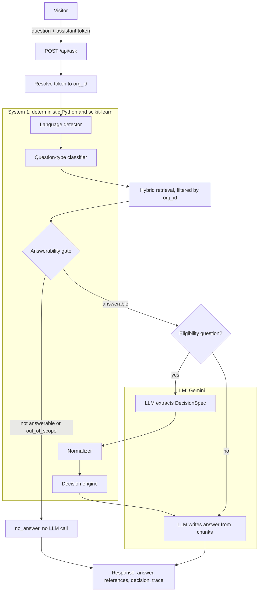
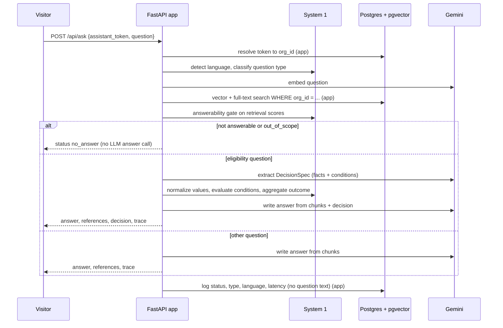

# KnowPilot Backend

FastAPI backend for KnowPilot, a multi-tenant AI knowledge and decision assistant for Indian
organizations. An organization registers, uploads up to 10 PDFs (max 20 pages and 10 MB each) and
gets a public assistant link plus an iframe embed code. Visitors ask questions without logging in,
in English, Hindi (Devanagari) or Hinglish. Answers come only from that organization's PDFs, with
references like `NIT_Scholarship_Policy_2025-26.pdf — Page 1`. If the documents don't cover the
question, the assistant says so. Eligibility questions are decided by Python code, not by the LLM.

| | |
|---|---|
| Live frontend | `<!-- TODO: https://YOUR-FRONTEND-URL -->` |
| Live API | `<!-- TODO: https://YOUR-API.onrender.com -->` |
| Demo assistant | `<!-- TODO: https://YOUR-FRONTEND-URL/a/ASSISTANT_TOKEN -->` |
| Frontend repo | `<!-- TODO: link to knowpilot-frontend -->` |

## Setup

**Prerequisites:** Python 3.11+ (developed on 3.13), a Supabase project (Postgres with the `vector`
extension, plus a private Storage bucket named `documents`), and a Google Gemini API key.

**Environment variables** (copy `.env.example` to `.env`):

| Variable | Purpose |
|---|---|
| `DATABASE_URL` | Supabase Postgres, `postgresql+psycopg://...` |
| `SUPABASE_URL`, `SUPABASE_SECRET_KEY` | Storage access (server only) |
| `SUPABASE_BUCKET` | Private bucket for the PDFs (default `documents`) |
| `GEMINI_API_KEY` | Gemini API key |
| `GEMINI_CHAT_MODEL`, `GEMINI_EMBED_MODEL` | Model names (never hardcoded) |
| `EMBED_DIM` | Embedding size, must match the pgvector column (768) |
| `JWT_SECRET` | Signs admin JWTs, at least 32 characters (startup fails otherwise) |
| `JWT_EXPIRE_MINUTES` | Admin token lifetime (default 720) |
| `FRONTEND_ORIGIN` | CORS origin(s) for admin routes, comma-separated |
| `PUBLIC_APP_URL` | Base URL used to build assistant links and embed code |
| `GATE_MIN_SIMILARITY`, `GATE_KEYWORD_MIN_SIMILARITY` | Answerability gate thresholds (0.60 / 0.55) |

**Run:**

```
py -3.13 -m venv .venv
.venv\Scripts\activate
pip install -r requirements.txt
copy .env.example .env          # then fill in the values
python scripts/setup_db.py      # applies db/schema.sql
uvicorn app.main:app --reload --port 8000
pytest                          # live Gemini tests are excluded; run them with: pytest -m live
```

Health check: `GET /api/health`. On Render, start with
`uvicorn app.main:app --host 0.0.0.0 --port $PORT` (see `render.yaml`). Don't add
`--forwarded-allow-ips="*"`: the rate limiter reads the client IP itself from the rightmost
`X-Forwarded-For` entry (the one Render's proxy appends, which visitors can't forge).

**Schema:** `db/schema.sql` creates `organizations`, `assistant_tokens`, `documents`, `chunks`
(with a pgvector embedding and a full-text `tsv` column, HNSW and GIN indexes) and `question_logs`.

**Seed the two fictional demo organizations** (API running):

```
python scripts/seed_demo.py [base_url]
```

Registers both orgs, uploads the PDFs in `sample-data/org1` and `sample-data/org2`, prints each
assistant URL. Safe to run again. See `sample-data/README.md`.

## Architecture





### PDF processing, chunking, retrieval, references

- **Upload** (`app/services/ingest.py`): validates type, size (10 MB), encryption, page count (20),
  text amount (300,000 characters), scanned PDFs (no text), duplicate filenames and the
  10-document limit. PyMuPDF extracts text page by page.
- **Chunking:** per page, never across pages. Paragraphs are split into sentences and packed to about
  900 characters with about 150 characters (whole trailing sentences) of overlap. Chunks under 40
  characters are dropped. Each chunk stores its `page_number`.
- **Embedding:** each chunk is embedded with the Gemini embedding model (768 dimensions) and stored in pgvector.
- **Hybrid retrieval** (`app/services/retrieval.py`): a cosine search over embeddings and a Postgres
  full-text search (stopwords removed, `simple` config) each return 24 candidates. They are merged
  with Reciprocal Rank Fusion (k = 60) and the top 6 chunks go on. Both queries filter on `org_id`
  and on documents with status `ready`.
- **Page references:** the LLM reports which file and page it used; the app maps each to a retrieved chunk and returns
  `{filename, page, snippet}`, with the snippet taken from the stored chunk text.

## AI architecture: who decides what

| Decision | Made by | Why |
|---|---|---|
| Which organization's data to use | App (token lookup) | Isolation must never depend on a model |
| Language (en / hi / hinglish) | System 1 (Devanagari check + Hindi word list) | Cheap, deterministic, no latency |
| Question type | System 1 (TF-IDF + logistic regression, `docs/classifier_report.md`) | Fast and inspectable; falls back to `policy` below 0.40 confidence |
| Which passages are relevant | Hybrid retrieval (pgvector + full-text + RRF) | Semantic match plus exact keywords (names, amounts) |
| Whether to answer at all | System 1 answerability gate on retrieval scores | A weak match returns `no_answer` without calling the LLM, so nothing is invented |
| Extracting facts and rules from text | LLM (`extract_spec.txt`) | Reading free text is what the LLM is good at |
| Normalizing values (lakh, crore, ₹, CGPA vs percentage) | System 1 normalizer | Numbers must be exact |
| Eligible / not eligible / needs more info | System 1 decision engine (boolean, choice and score evaluators run in parallel) | The LLM never decides eligibility; Python does |
| Final wording, in the user's language | LLM (`answer.txt`) | Fluent multilingual text; it receives the decision and must not override it |
| If the LLM is unavailable | App fallback: `passages_only` with the top 3 passages | Visitors still get sourced text |

## Security and isolation

- Every query touching documents or chunks filters by `org_id`.
- Assistant tokens work only on `/api/ask` and `/api/assistant/{token}/info`; every other route needs an admin JWT. Regenerating a token revokes the old one immediately.
- Unknown or foreign document ids return 404, the same as missing ones.
- Passwords are hashed with bcrypt. `JWT_SECRET` must be 32+ characters.
- The PDFs live in a private Storage bucket; no endpoint returns files or download links.
- Question text and personal facts (income, category, CGPA) are never logged or stored; `question_logs` keeps only status, type, language, decision outcome and latency.
- Public routes are rate limited (20 requests/minute per IP, 200 per assistant token). CORS is open only for the two public routes.
- All errors return `{"error": {"code": "...", "message": "..."}}`.
- A scan of the full git history for keys, connection strings and the values in `.env` found no secrets.

Isolation tests (`pytest tests/test_isolation.py -v`, run against the real database and Gemini):

```
tests/test_isolation.py::test_retrieval_is_isolated PASSED               [  7%]
tests/test_isolation.py::test_answers_are_isolated PASSED                [ 15%]
tests/test_isolation.py::test_foreign_document_id_is_404 PASSED          [ 23%]
tests/test_isolation.py::test_assistant_token_rejected_on_every_admin_route PASSED [ 30%]
tests/test_isolation.py::test_regenerated_token_is_404_on_ask PASSED     [ 38%]
tests/test_isolation.py::test_usage_counts_own_org_only PASSED           [ 46%]
tests/test_isolation.py::test_out_of_scope_skips_llm PASSED              [ 53%]
tests/test_isolation.py::test_llm_failure_returns_passages PASSED        [ 61%]
tests/test_isolation.py::test_question_length_validated PASSED           [ 69%]
tests/test_isolation.py::test_not_covered_is_no_answer PASSED            [ 76%]
tests/test_isolation.py::test_db_drop_retried_once_then_503 PASSED       [ 84%]
tests/test_isolation.py::test_no_answer_trace_hides_filenames PASSED     [ 92%]
tests/test_isolation.py::test_teardown_deletes_orgs_even_when_setup_fails PASSED [100%]
======================= 13 passed in 117.80s (0:01:57) ========================
```

## API endpoints

Full request and response shapes: [`docs/API_CONTRACT.md`](docs/API_CONTRACT.md).

| Method | Path | Auth | Purpose |
|---|---|---|---|
| GET | `/` | none | Status page |
| GET | `/api/health` | none | Health and database check |
| POST | `/api/auth/register` | none | Create organization and admin, returns JWT |
| POST | `/api/auth/login` | none | Admin login |
| GET | `/api/auth/me` | JWT | Current organization |
| POST | `/api/documents` | JWT | Upload and index a PDF |
| GET | `/api/documents` | JWT | List documents and limits |
| DELETE | `/api/documents/{id}` | JWT | Delete a document, its chunks and file |
| GET | `/api/assistant` | JWT | Assistant URL, token and embed code |
| POST | `/api/assistant/regenerate` | JWT | Revoke and reissue the token |
| GET | `/api/assistant/{token}/info` | token | Org name and suggested questions |
| POST | `/api/ask` | token | Ask a question |
| GET | `/api/usage` | JWT | Question counts for the organization |

## Test data and evaluation

- `sample-data/` holds two fictional organizations (Navodaya Institute of Technology and Navyug
  Infotech), their PDFs, the generator (`generate_pdfs.py`) and an embeddable demo page
  (`embed-demo/index.html`: replace the marked iframe `src` with a real assistant URL).
- `sample-data/test_questions.md` / `.json`: 14 questions (direct, policy, procedural, comparison,
  two multi-condition eligibility, one needs-more-info, one Hinglish, two not in the documents, two
  cross-tenant) with expected status, type, outcome and reference.
- `python scripts/run_eval.py [base_url]` asks them through `/api/ask` and writes
  [`docs/eval_results.md`](docs/eval_results.md). Latest local run: **13 of 14 passed**. The one
  failure is question 5 (ELIGIBLE expected): in that run the LLM's fact extraction left a condition
  unknown, so the engine returned NEEDS_MORE_INFO; the same question returned ELIGIBLE when asked
  again, so extraction is not fully deterministic.
- Classifier: 78% accuracy in 5-fold cross-validation on 160 labelled questions (`docs/classifier_report.md`).

## Known limitations

- **Rate limiter is in-memory (use Redis in production).** Counters live in one process: they
  reset on restart and aren't shared across instances. Each store holds at most 50,000 live keys
  (IPs grouped by IPv4 address / IPv6 /64). When full, it refuses new keys (fail closed) rather
  than evicting live counters, so a botnet-scale flood from more than 50,000 distinct networks
  per minute would block new visitors while existing ones keep working. Evicting instead would
  let the same attacker reset their own limits. Moving the counters to Redis with TTLs removes
  both the capacity limit and the single-instance restriction.
- Question-type classification is about 78% accurate, so some questions are routed to the wrong type (for example a plain rule question treated as an eligibility question).
- Eligibility facts are extracted by an LLM and can occasionally be missed, giving NEEDS_MORE_INFO where the facts were stated.
- PDFs must contain selectable text; scanned images are rejected (no OCR).
- Indexing happens inside the upload request, so large uploads can take up to about a minute.
- Hindi and Hinglish detection uses a fixed word list; unusual Hinglish may be detected as English.
- The assistant has no conversation memory; each question is answered on its own.
